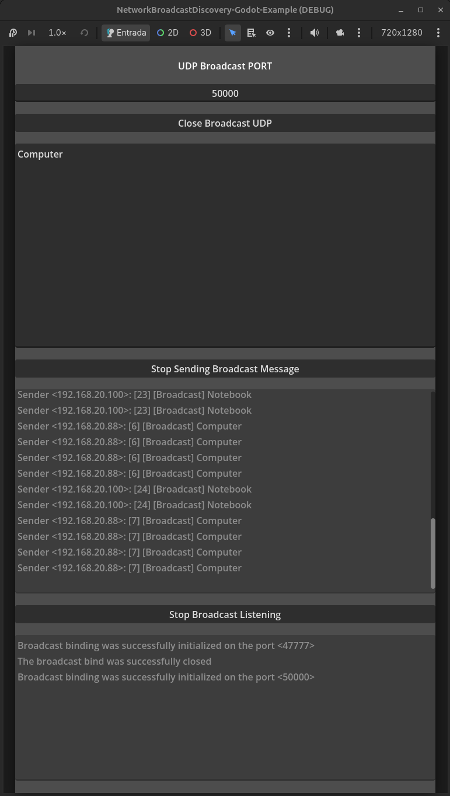

# Network Broadcast Discovery - Godot Example

## Overview

Network Broadcast Discovery is an educational demo project built with Godot 4.7. It shows how devices on a local network can announce and discover one another using UDP broadcast and multicast.

The main scene provides a small interface to choose a UDP port, send a text announcement, and inspect received messages and their sender IP addresses. This is a standalone example project, not a plugin or a complete server browser.

## Screenshots

 |

## Features

- Configurable UDP port, defaulting to `47777`.
- Periodic UTF-8 announcements, sent once per second.
- Global broadcast, multicast, and per-interface broadcast destinations.
- Incoming message display with sender IP address.
- A simple log for socket initialization and shutdown.
- Godot 4.7 project with no additional plugins required.

## How It Works

### 1. Initialize the UDP Socket

The discovery manager creates a `PacketPeerUDP` and binds it to the selected port. It enables broadcast and attempts to join the multicast group `239.255.77.77` on each local network interface.

### 2. Announce a Message

When sending is enabled, the main scene sends the entered text once per second. Each UTF-8 packet uses this format:

```text
[id] [Broadcast] message text
```

The ID starts at `1` and increments for each announcement from that instance. Each packet is sent to `255.255.255.255`, `239.255.77.77`, and broadcast addresses derived from local IPv4 interfaces (/24).

### 3. Listen for Announcements

When listening is enabled, the scene checks for received packets and displays the sender IP and decoded message. Sending and listening can both be enabled in the same initialized instance.

## What You Can Learn

By exploring this example, you can learn about:

- Binding a UDP peer to a port and using the same socket to send and receive datagrams.
- Using broadcast and multicast for local network discovery.
- Enumerating local interfaces and deriving candidate IPv4 broadcast destinations.
- Encoding a small announcement as UTF-8 and identifying the sender of a received packet.
- The difference between announcing a service and establishing a connection to it.

## Getting Started

1. Open `project.godot` in Godot 4.7 and run the configured main scene.
2. On each of two different machines on the same LAN, enter the same available UDP port (the default is `47777`) and click **Initialize Broadcast UDP**.
3. On one machine, enter a message and click **Start Sending Broadcast Message**.
4. On the other machine, click **Start Broadcast Listening** to view announcements.
5. Stop sending/listening and click **Close Broadcast UDP** when finished.

Testing requires two different machines. The UDP socket binds the selected port without enabling port reuse, so a second instance cannot bind the same port on the same machine.

## Important Networking Notes

UDP does not guarantee delivery, ordering, or duplicate protection. This example periodically sends announcements, but does not implement acknowledgements, a handshake, or connections to discovered services.

Per-interface broadcast addresses are approximated by assuming a `/24` subnet mask. Networks with other masks may require a subnet-aware broadcast calculation. Routers, wireless access points, operating systems, and firewalls can also block broadcast or multicast traffic, especially across subnet boundaries.

For Android exports, enable the `CHANGE_WIFI_MULTICAST_STATE` permission. The project calls `PacketPeerUDP.set_broadcast_enabled(true)` to send broadcast packets.

The listener reads one available packet per frame. A multicast join failure is logged, but does not make initialization fail if binding the UDP port succeeded.

## Intended Audience

This project is for Godot developers learning UDP networking, indie developers exploring LAN discovery, and anyone looking for a small GDScript example to adapt for local network experiments.

## Source Code

[NetworkBroadcastDiscovery-Godot-Example on GitHub](https://github.com/AchcarLucas/NetworkBroadcastDiscovery-Godot-Example)

## License

The project is licensed under MIT. See [LICENSE](LICENSE).
